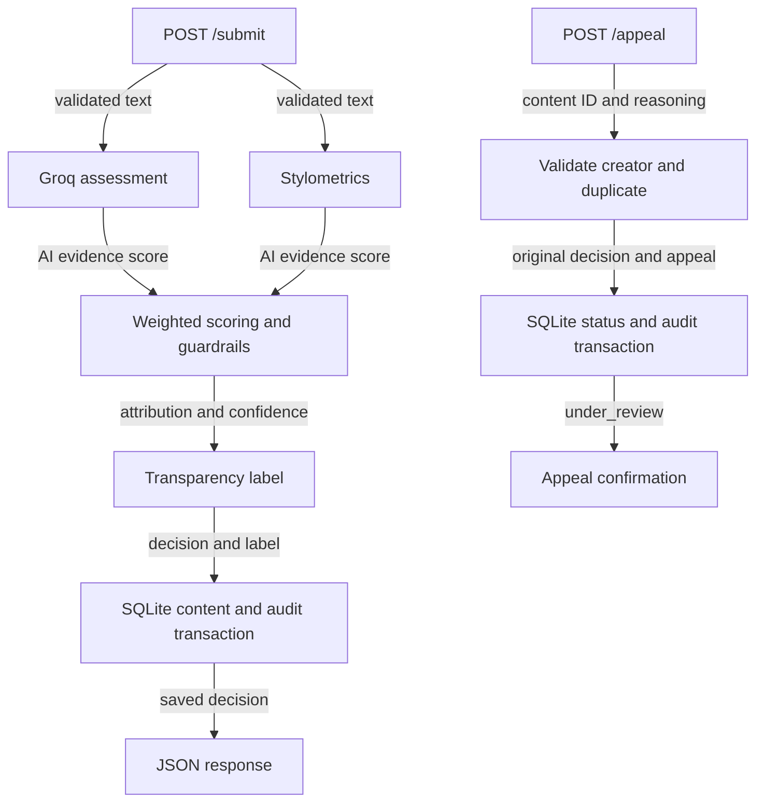

# Provenance Guard: project plan

The first version of this plan was written before the implementation. This revision keeps the same design and updates the wording to match the code.

The project covers the required submission pipeline, labels, appeals, rate limiting, and audit log. Stretch features are outside the current scope.

## Detection signals

The two checks should look at different aspects of the passage. Asking two models the same question would add another opinion, but it would not provide the structural measurements available from a separate Python check.

1. **Groq language-model assessment:** semantic/contextual evidence of AI authorship. Returns `{score: float, reasoning: string, available: bool, model: string}`. Score is AI evidence from 0 to 1. Formality alone is insufficient evidence; author identity must not influence assessment. Blind spots: prompt injection, convincing imitation, editing, dialect and genre bias. Submitted text is untrusted data, never instructions.
2. **Stylometrics:** pure Python sentence-length coefficient of variation, type-token ratio, and punctuation density. These measure structural regularity rather than semantic content. The composite returns the same 0–1 AI-evidence scale plus measured metrics. Uniform sentences and low diversity increase evidence; these are weak hypotheses, not established proof. Poems, technical prose, and short passages can violate them.

Combine `p = 0.75 * llm_score + 0.25 * style_score`. This is a heuristic evidence score, **not an empirically calibrated probability**. Short text (under 40 words), fewer than three sentences, disagreement exceeding 0.45, or an unavailable model restrict p to [0.30, 0.70]. A missing model uses neutral 0.5, explicitly marked unavailable; it never pretends to be a second successful signal.

## Scores and uncertainty

`ai_score = p`, and `confidence = max(p, 1-p)` is strength in the leading direction. At p=0.60, the model weakly leans AI; confidence is 0.60 and attribution remains uncertain. At p=0.51 the output is uncertain, while p=0.95 supports likely AI. These values are not real-world accuracy estimates. A held-out, independently sourced human/AI corpus would be required for calibration, reliability diagrams, and false-positive measurement.

- Likely AI: p >= 0.85, with both individual scores >= 0.70 and no guardrail.
- Likely human: p <= 0.20, with both scores <= 0.35 and no guardrail.
- Otherwise: uncertain.

The higher AI threshold reflects the harm of falsely accusing a human writer. Do not punish or remove content automatically.

## Label text

| Attribution | Exact text |
| --- | --- |
| likely_ai | "Likely AI-generated: both checks found strong AI-like patterns. This is an automated estimate, not proof of authorship. The creator can appeal." |
| likely_human | "Likely human-written: both checks found patterns consistent with human writing. This is an automated estimate, not verified authorship." |
| uncertain | "Authorship uncertain: the checks do not provide enough consistent evidence. This content should not be treated as confirmed AI-generated or confirmed human-written." |

## Architecture

Submissions pass validation and an IP-based rate limit before both signals run. Scoring and labels are persisted atomically with an immutable decision event, then returned to the client. Appeals preserve the original decision, set current status to `under_review`, and append a separate audit event in the same transaction.

## API contract

- `POST /submit`: `{text, creator_id}` → 200 `{content_id, creator_id, attribution, confidence, ai_score, label, signals, guardrails, status, timestamp}`.
- `POST /appeal`: `{content_id, creator_id, creator_reasoning}` → 200 confirmation. Reasoning must have 10–2000 characters. Creator ID must match the submission; this is a demonstration check, not authentication.
- `GET /content/<id>`: persisted decision and current status.
- `GET /appeals`: review queue with original decision, content text and creator reasoning.
- `GET /log?limit=20`: newest structured events; limit 1–100.
- `GET /health`: status and detection mode; no secrets.

Invalid input → 400/413/415; missing content → 404; creator mismatch → 403; duplicate appeal → 409; submission rate exceeded → JSON 429. Default limit: 10/minute and 100/day per remote IP, memory backend for one local process. Do not trust client-supplied forwarding headers.

## Appeals and cases to watch

A creator can appeal their own submission regardless of the original label. The request needs the content ID, creator ID, and a reason. The server should preserve the original decision, save the reasoning and timestamp, and change only the current status to `under_review`.

A reviewer needs the text, both signal results, confidence, label, and appeal reasoning in one place. A second appeal for the same content should return 409 without creating another log entry. Matching creator IDs is enough for the local demonstration, but real accounts and reviewer decisions would need a separate implementation.

- Repetitive poetry and formal non-native English may look statistically uniform: conservative AI threshold, sparse-text guardrail, and appeals reduce harm.
- Very short fragments lack statistical evidence: force uncertainty even if the LLM sounds confident.
- Mixed human/AI passages or paraphrased AI may make signals disagree: force uncertainty when disagreement > 0.45.
- Provider failure or malformed model JSON: mark unavailable and return uncertain; log degraded decision rather than inventing an LLM answer.
- Concurrent appeals: unique database constraint and a transaction protect against duplicate records.

## AI Tool Plan

| Milestone | Spec context given to AI | Requested output | Verification |
| --- | --- | --- | --- |
| M3 | Detection signals, API contract, architecture diagram | Flask skeleton, standalone Groq signal, SQLite audit persistence | Direct signal tests using a fake provider; route JSON and persistence checks; live Groq run when a key is available |
| M4 | Signals, uncertainty representation, diagram | Standalone stylometrics and weighted scoring | Four deliberately selected sample texts; inspect both scores; threshold/disagreement/short-input tests; no claims of empirical calibration |
| M5 | Labels, appeals, diagram | Label mapping, appeals, rate limit | All three label texts through controlled full-route tests; status/log/duplicate/ownership tests; 12 requests producing ten 200s and two 429s |

## Testing

Use fixed model responses for tests that need a specific score. That makes it possible to check thresholds and labels reliably while still running the real structural signal, database, and API routes. Save the resulting audit events and the twelve-request rate-limit output.

Run the four sample passages against Groq separately when a key is available. Compare both signals, especially for the two borderline passages. Keep the live results separate from the fixed-score test results so it is clear what each run demonstrates.
